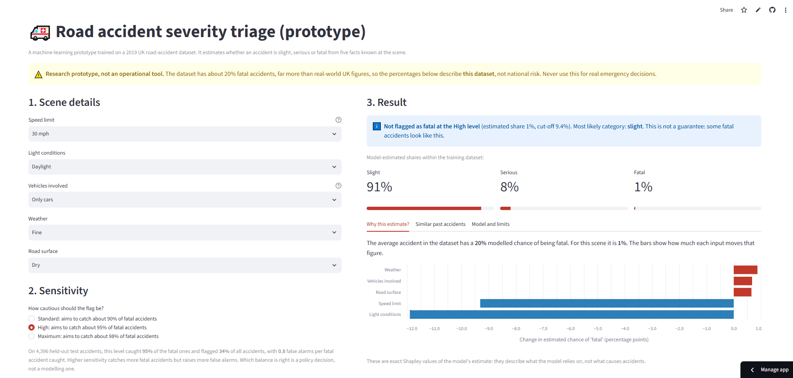
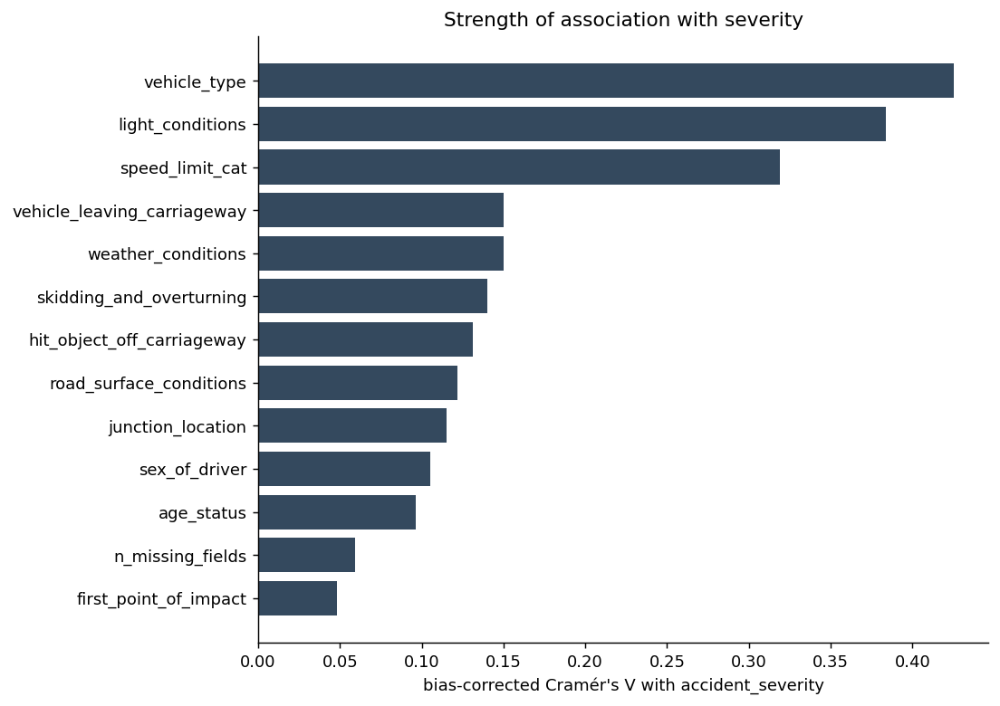
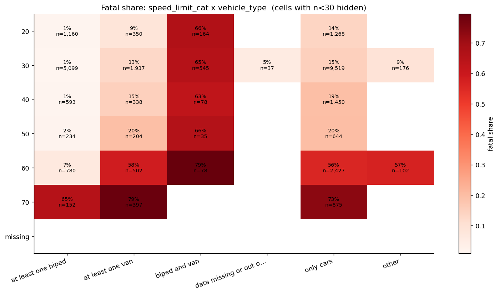
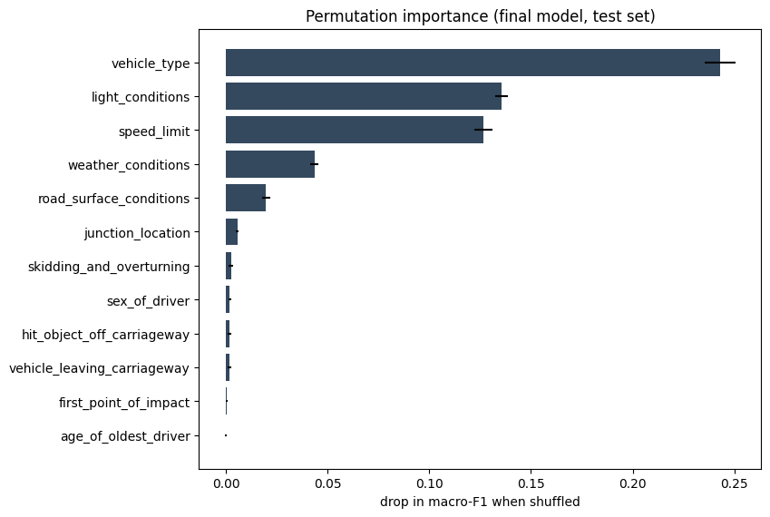
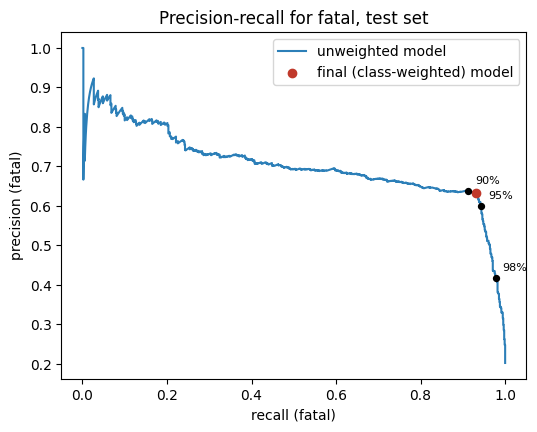

# UK Road Accident Severity: from scene facts to a triage prototype

[](https://github.com/ridwanoduola/uk-road-accident-severity/actions/workflows/ci.yml)
[](https://uk-road-accident-severity.streamlit.app/)

**Live demo: https://uk-road-accident-severity.streamlit.app/**



Can the severity of a UK road accident (**slight, serious or fatal**) be predicted from facts available at the scene, and do **neural networks** beat traditional machine learning at it? This project answers both questions end to end: data audit and cleaning, exploratory analysis, a statistically careful model comparison, a locked test set, error analysis, and a deployed app.

## Key findings

1. **Severity is partly predictable.** On a held-out test set of 4,396 accidents, tuned gradient boosting reaches **macro-F1 0.775** (95% CI 0.762 to 0.788; always guessing the most common class gives 0.196) and catches **93% of fatal accidents**.
2. **Neural networks did not help.** A 5-seed neural-network ensemble scored 0.774. The paired difference to gradient boosting is +0.001 macro-F1 (95% CI -0.002 to +0.004; McNemar p = 0.89). Both beat balanced logistic regression by about 1 point (p = 0.002).
3. **Five facts do almost all the work:** vehicle type, light conditions, speed limit, weather and road surface. A model on just these five loses about 1 point of macro-F1 and none of the fatal-accident recall.
4. **The data, not the algorithm, is the limit.** A plain lookup table of the five inputs scores 0.757. Even on the rows it was built from it is right only 77% of the time, so about 1 in 4 accidents has a different outcome from the typical one for its recorded conditions.
5. **The operating point is a policy choice.** The app offers three sensitivity levels (aiming for 90%, 95% and 98% of fatal accidents). Catching the last few percent is expensive: going from 95% to 98% roughly doubles the false alarms per fatal accident caught.

## Data

Source: Department for Transport, [Road Safety Data](https://www.data.gov.uk/dataset/cb7ae6f0-4be6-4935-9277-47e5ce24a11f/road-safety-data) (STATS19 police-reported injury accidents in Great Britain), published on data.gov.uk under the [Open Government Licence v3.0](https://www.nationalarchives.gov.uk/doc/open-government-licence/version/3/). *Contains public sector information licensed under the Open Government Licence v3.0.*

The file `uk_road_accident_2019.csv` used here is a pre-processed extract of the 2019 records (31,647 rows, 14 columns: an ID, 12 input variables and the severity label). How it was filtered or resampled is not documented. No raw data is stored in this repository; place the file in `data/raw/`.

| Cleaning step | Rows affected |
|---|---|
| Exact duplicate records removed (identical on every column including the accident ID) | 1,172 |
| Blank severity label, set aside as unlabeled | 1,172 |
| Severity written in mixed case (`Fatal`, `Serious`, `Slight`), standardised | 50 |
| Speed limit coded `-1`, treated as missing | 24 |
| Driver age under 16 in car-only or van-only accidents (implausible), set to missing | 6 |
| **Labelled records used for modelling** | **29,303** (41.6% slight, 38.2% serious, 20.2% fatal) |

Rows that share the same feature values were kept: they are different accidents. Missing-data categories were kept as information, not dropped.

Split: **85% development (24,907 rows) / 15% locked test (4,396 rows)**, stratified by severity. All tuning and model selection used 5-fold cross-validation on the development set.

**Important caveat on the data.** About 20% of accidents here are fatal. Official figures for Great Britain in 2019 show that 1,752 of 153,158 reported casualties (about 1.1%) were killed ([DfT, Reported road casualties Great Britain: annual report 2019](https://www.gov.uk/government/statistics/reported-road-casualties-great-britain-annual-report-2019)), and the share of accidents that are fatal is similarly small (the DfT's table RAS10013, reported personal injury road accidents by severity, gives the exact accident-level figure). Together with some unusually sharp patterns, this suggests the extract was filtered or resampled from the official records. Its processing and its category definitions were not independently verified, so **every result describes this dataset, not UK roads in general**.

## What the data shows

| | |
|---|---|
|  |  |

- Fatal share rises with speed limit: 11% at 20 mph, 12% at 30, 47% at 60 and 74% at 70, with a sharp step between 50 and 60 mph. Speed limit probably stands in for road type (rural and dual-carriageway roads), but the data has no road-type column to confirm this.
- Fatal share is 39% in darkness against 12% in daylight.
- Vehicle type has the strongest association, and it is not just speed in disguise: within each speed limit the vehicle-type gaps remain, although they narrow at 70 mph.
- Driver age is almost irrelevant (effect size 0.003), and the categories marked "data missing or out of range" carry a lower fatal share (about 8% to 10%), which looks like a record-completeness effect and is a risk for any model.

## Method

| Phase | What was done |
|---|---|
| Audit and cleaning | Value-level audit of every column, then cleaning rules written from what was actually in the data (`src/inspect_values.py`, `src/extra_checks.py`, `src/data.py`) |
| Features | Row-wise engineered features (darkness, high speed, darkness x speed, crash-event count, missing-field count, driver-unknown); all learned preprocessing lives inside scikit-learn pipelines to prevent leakage |
| Models | Logistic regression, decision tree, random forest, HistGradientBoosting, XGBoost, LightGBM, and four PyTorch neural networks (one-hot and embedding inputs, 3 seeds per fold) |
| Imbalance | Unweighted vs balanced class weights (the imbalance is mild, so resampling methods such as SMOTE were not used) |
| Comparison | Identical folds for every model, paired tests with the Nadeau-Bengio correction, bootstrap confidence intervals and McNemar tests on the test set |
| Final evaluation | Test set scored once for the 12-input comparison (`src/final_eval.py`) |
| Interpretation | Permutation importance, error analysis by feature profile and subgroup, calibration, threshold and cost analysis, input ablation, lookup-table benchmark |
| Deployment | Five-input model with calibrated probabilities and three sensitivity levels, served by a Streamlit app with exact Shapley explanations |

## Results

### Model comparison (5-fold cross-validation on the development set, macro-F1)

| Model | macro-F1 | Fatal recall | Fatal precision |
|---|---|---|---|
| HistGradientBoosting (balanced weights) | 0.769 ± 0.004 | 0.931 | 0.607 |
| Neural network, one-hot [256,128,64] | 0.768 ± 0.004 | 0.934 | 0.605 |
| Neural network, embeddings [256,128] | 0.768 ± 0.004 | 0.931 | 0.604 |
| Random forest (balanced) | 0.768 ± 0.005 | 0.917 | 0.609 |
| XGBoost (balanced) | 0.765 ± 0.005 | 0.902 | 0.610 |
| Logistic regression with interactions | 0.764 ± 0.005 | 0.906 | 0.607 |
| Logistic regression (balanced) | 0.762 ± 0.005 | 0.889 | 0.607 |
| Logistic regression (no class weights) | 0.755 ± 0.005 | 0.819 | 0.617 |

Every model lands in a narrow band (0.755 to 0.769). The top four differ by less than the fold-to-fold noise. The picture is the same when folds are grouped so that no feature profile appears in two folds (HistGradientBoosting 0.770 grouped vs 0.769 random), so the models are not simply memorising profiles. Hyper-parameter tuning added +0.0016 macro-F1 (sd 0.0022, better in 3 of 5 folds), which is within noise. Full tables: `reports/model_comparison_random.txt`, `reports/model_comparison_grouped.txt`, `reports/paired_tests_random_with_nn.txt`, `reports/nn_summary_random.txt`, `reports/tuning_hgb.txt`.

### Final test-set evaluation (4,396 accidents, evaluated once)

| Model | Accuracy | macro-F1 [95% CI] | Fatal recall [95% CI] | Fatal precision |
|---|---|---|---|---|
| Majority class | 0.416 | 0.196 [0.191, 0.201] | 0.000 | 0.000 |
| Logistic regression (balanced) | 0.770 | 0.765 [0.752, 0.778] | 0.889 [0.868, 0.909] | 0.627 |
| **HistGradientBoosting (tuned)** | **0.779** | **0.775 [0.762, 0.788]** | **0.931 [0.914, 0.948]** | 0.633 |
| Neural network (5-seed ensemble) | 0.778 | 0.774 [0.761, 0.787] | 0.935 [0.918, 0.950] | 0.624 |

HistGradientBoosting vs the neural network: macro-F1 difference +0.0010 (95% CI -0.0022 to +0.0043), McNemar p = 0.885 (the two disagree on only 48 of 4,396 cases). Versus logistic regression: +0.0104 (95% CI +0.0052 to +0.0159), p = 0.002. The test score sits inside the cross-validation range, so there is no sign of optimistic tuning. Full output: `reports/final_test_results.txt`.

### Why the ceiling is where it is



Shuffling vehicle type, light, speed limit, weather and road surface costs 0.24, 0.14, 0.13, 0.04 and 0.02 macro-F1; every other variable costs 0.006 or less.

| Inputs used (tuned model, cross-validation) | Variables | macro-F1 | Drop vs all 12 | Fatal recall |
|---|---|---|---|---|
| All variables | 12 | 0.771 | n/a | 0.928 |
| Scene-only (no post-crash variables) | 8 | 0.766 | -0.46 pts | 0.926 |
| Scene-only without driver sex and age | 6 | 0.765 | -0.58 pts | 0.927 |
| **Core five (deployed)** | **5** | **0.761** | **-0.97 pts** | **0.929** |
| Top three (vehicle, light, speed) | 3 | 0.729 | -4.2 pts | 0.950 |

On the core five, a lookup table of the 480 observed input combinations (predict the commonest past outcome) scores macro-F1 0.757 against 0.761 for the model, and its in-sample accuracy is only 0.774. The model has therefore extracted essentially all the information in those variables. What remains is variation the dataset does not record (for example impact speed or seat-belt use), not a weakness of the algorithm. Details: `reports/ablation.txt`, `reports/error_analysis.txt`.

### Deployed model and sensitivity levels

The deployed model uses the five core inputs, with no class weights, so its probabilities are calibrated (expected calibration error 0.012 on the test set; ROC-AUC 0.923). Thresholds on P(fatal) were chosen on out-of-fold development predictions and transferred almost exactly to the test set (targets of 90%, 95% and 98% became 90.4%, 94.6% and 98.2%).

| Level | Cut-off | Fatal accidents caught | Flags that were fatal | Share of accidents flagged | False alarms per fatal caught | Accuracy |
|---|---|---|---|---|---|---|
| Standard | 0.428 | 90.4% | 62.9% | 29.1% | 0.59 | 0.773 |
| High | 0.094 | 94.6% | 55.6% | 34.5% | 0.80 | 0.744 |
| Maximum | 0.020 | 98.2% | 37.5% | 53.0% | 1.66 | 0.591 |



## Limitations

- **Dataset prevalence.** With about 20% of accidents fatal here, "flags that were fatal" would be far lower in the real world. If the same hit and false-alarm rates held at a 1% to 2% fatal share, roughly 1 flag in 8 to 16 would be right. This is an illustration, not a forecast.
- **Provenance.** The dataset appears to be filtered or resampled and its category definitions were taken as provided.
- **Limited information.** Five coarse facts cannot separate accidents with identical recorded conditions; about 1 in 4 differ from the typical outcome.
- **Weaker areas.** In the test data, the model caught only about half of the rare fatal cases in the "at least one biped" group (31 cases), and it was less accurate in darkness (67%) than in daylight (82%).
- **Possible record-completeness effect.** Categories marked "data missing" have a lower fatal share, which may reflect how thoroughly accidents are recorded rather than their severity.
- **Test-set use, disclosed.** The test set scored two models, the 12-input comparison and the deployed five-input model. It was also used for post-hoc analysis (permutation importance, subgroup breakdowns, calibration and threshold reporting). Every modelling choice (inputs, thresholds, hyper-parameters) used development data only.
- **Not validated for operational use.** This is a research prototype; its explanations describe what the model relies on, not what causes accidents.
- **Fairness.** Driver sex and age were excluded from the deployed model: they added almost nothing, and using them to triage emergencies would be hard to justify.

## Reproduce

```bash
git clone https://github.com/ridwanoduola/uk-road-accident-severity.git
cd uk-road-accident-severity
pip install -r requirements-dev.txt        # full environment (PyTorch CPU: see the note inside the file)
# place uk_road_accident_2019.csv in data/raw/

python -m src.inspect_values               # value audit
python -m src.data                         # clean data, print the cleaning log
python -m src.extra_checks                 # duplicates, missingness, cross-checks
python -m src.eda                          # figures and association summary
python -m src.split                        # development / test split
python -m src.baseline                     # first baselines
python -m src.experiments                  # 9 models (add --grouped for the stricter folds)
python -m src.compare_stats                # paired tests
python -m src.tune --trials 40             # Optuna tuning of HistGradientBoosting
python -m src.nn                           # neural networks (about 20 minutes on a laptop)
python -m src.compare_stats --with-nn
python -m src.final_eval                   # test set, run ONCE (refuses to run twice)
python -m src.error_analysis
python -m src.operating_point
python -m src.ablation
python -m src.deploy_model                 # builds models/triage_model.joblib, run ONCE
streamlit run app/streamlit_app.py
pytest -q
```

To run only the app: `pip install -r requirements.txt` then `streamlit run app/streamlit_app.py`. The saved model is a pickle, so the pinned scikit-learn, pandas and numpy versions matter; on Streamlit Community Cloud select Python 3.13.

## Repository layout

```
app/            Streamlit app
src/            data cleaning, features, models, evaluation and analysis scripts
tests/          automated tests (30), run on every push by GitHub Actions
models/         the deployed model (triage_model.joblib) and tuned parameters
reports/        every result quoted above as text files, plus figures in reports/figures
requirements.txt        slim runtime environment (what the live app uses)
requirements-dev.txt    full environment to reproduce the project
```

## Tech stack

Python, pandas, NumPy, scikit-learn, XGBoost, LightGBM, PyTorch, Optuna, SciPy, matplotlib, Streamlit, pytest, GitHub Actions.

## Author

**Ridwan Oduola**: statistics and computer science graduate working in data analytics, machine learning and web development. [Portfolio](https://oduola.co.uk/portfolio) | [LinkedIn](https://linkedin.com/in/ridwanoduola)
